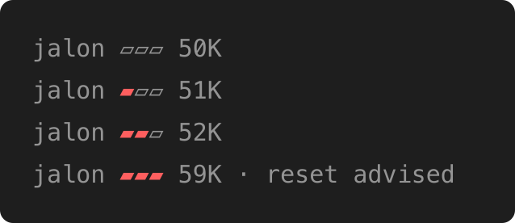

<p align="center">
  <picture>
    <source media="(prefers-color-scheme: dark)" srcset="assets/wordmark-dark.svg">
    
  </picture>
</p>

**A context advisor for AI coding agents.**

Jalon tells you when a long conversation is worth resetting, and has the session's own model prepare the reset: a new session, a handoff file to resume from, or a `/compact` line that names what to keep. One binary, two hooks, no daemon, no network.

> **Status: pre-alpha.** Tested with Claude Code on macOS; the test suite also runs on Linux in CI.

A coding agent resends its whole conversation on every request, and most of what you pay for, or burn from your quota, is that context being read again: in five days of my own sessions, a request at 400K tokens cost three and a half times one at 100K. Resetting on time, without losing what matters, saves those tokens: see [cost and quality](docs/cost-and-quality.md). The client shows how full the context is, not when a reset is worth it; Jalon does.

## What you see

When a conversation's context has grown by 200K tokens above its starting size, and again after every further 150K, the model ends its answer with one recommendation, in your language, in a quoted block that starts with **Jalon**: a new session, a handoff to resume from, or a `/compact` line. You run the command; Jalon never does. In a terminal you also get a one-line notice, and the status line shows a pole whose three bands fill as the context grows, full when a reset is advised: `jalon ▰▰▱ 160K`. A Claude Code mod can draw the same pole above the prompt instead, in the terminal and in Claude Desktop ([the pole above the prompt](docs/how-it-works.md#the-pole-above-the-prompt)).



*A real Claude Code session, with `advise_tokens` lowered to 15K so the pole fills in a few prompts.*

See [how it works](docs/how-it-works.md) and [handoffs](docs/handoffs.md).

## How Jalon differs

- **From context warnings** ([ctxwatch](https://github.com/drewkett/ctxwatch), [claude-context-notify](https://github.com/kawaz/claude-context-notify), [context-monitor](https://github.com/aeriondyseti/context-monitor), [better-compact](https://github.com/koenvdheide/better-compact) and the like), which compare the size to a fixed threshold or a share of the window: Jalon counts the growth above the conversation's starting size, so a session that starts heavy with MCP tools or a long `CLAUDE.md` is not advised earlier, and the model, which knows the task, picks one reset and prepares it.
- **From lowering the auto-compact threshold** (`/autocompact`): that moves the trigger, but a compaction keeps the summary a summarizer writes without knowing what comes next. In a replay of four of my conversations cut at about 300K, a handoff did better than a plain `/compact` in three, and re-read about 1.6M tokens against about 3M ([cost and quality](docs/cost-and-quality.md)).
- **From handoff skills** (`/handoff` and the like), which you run when you think of it: Jalon tells you when, asks the handoff to separate what was checked from what was not, keeps it up to date until you reset, and gives a resume line that cost $0.17 a run against $0.32 for a plain "resume from it" ([handoffs](docs/handoffs.md#resuming)).
- **From compaction helpers** ([compact-plus](https://github.com/u-ichi/compact-plus)), which improve what a compaction keeps: Jalon does not touch the compaction; it advises before one.

Every figure here comes from my own sessions with one model: a hint, not a proof. `jalon context-report` replays the advice on your own transcripts, so you can check it against your history ([impact report](docs/impact-report.md)). Jalon makes no network call and no model call of its own: the advice, the handoff and its updates are requests of your own session, and the stop hook makes the model go on at most once per turn ([how it works](docs/how-it-works.md)).

## Install

With [Homebrew](https://brew.sh) on macOS:

```sh
brew install a-lafon/tap/jalon
jalon init    # adds the hooks and the status line to ~/.claude/settings.json, and the /jalon-* commands
```

For Linux and the other ways, see [installing Jalon](docs/install.md).

To draw the pole above the prompt instead of in the status line, with Claude Code 2.1.292 or later, run `jalon init --mod`: see [the pole above the prompt](docs/how-it-works.md#the-pole-above-the-prompt) for its limits.

Then start a new Claude Code session, in the terminal or in VS Code, and work as usual. `jalon init --dry-run` shows what it would change; see [configuration](docs/configuration.md) for its flags.

When the stop hook makes the model go on, the terminal labels what it asked the model `Stop hook error`: that is Claude Code's label for any hook that makes the model go on, not a failure of Jalon ([how it works](docs/how-it-works.md#what-you-see)).

## Commands

`jalon init` adds these commands to Claude Code, unless you run it with `--skill=false`. Only you invoke them: the model never runs one on its own.

| Command | What it does |
|---|---|
| `/jalon-resume [path or words]` | Resumes from this project's latest handoff, or the one named, rather than `@` and its path. |
| `/jalon-recap [path or words]` | Sums up a whole thread of handoffs, back to the first. |
| `/jalon-handoff [what to stress]` | Writes a handoff now, before the advice comes. |
| `/jalon-report [flags]` | Runs `jalon context-report` and explains it. |
| `/jalon-help` | Lists these commands. |

See [handoffs](docs/handoffs.md#resuming).

## Update

Jalon makes no network call, so it does not check for updates: run `brew outdated`, or watch the [releases](https://github.com/a-lafon/jalon/releases). Then `brew upgrade jalon`. The hooks keep working, but an upgrade from 0.1.0 needs `jalon init` once more, to add the stop hook; it keeps the mod if you use it. From 0.2.0, `jalon init` also replaces `/jalon resume` with the `/jalon-*` commands. Other install methods update as described in [installing Jalon](docs/install.md#update).

## What Jalon touches

Jalon advises; you act. It never:

- **runs a command**: you type `/clear`, `/compact` or the resume line yourself;
- **rewrites anything** in a prompt, the conversation or a tool output;
- **sends anything anywhere**: it makes no network call, and reads your transcripts on your machine;
- **moves, edits or deletes a handoff**.

It writes only:

- **the advice**, added to the model's context by the prompt hook, on a prompt you typed, when the threshold is crossed; or by the stop hook at the end of a turn you started, which makes the model go on once to add the section: when the threshold was crossed during the turn, or when the reply left out the section asked for. Only a session you typed in gets it: a session a program started with `claude -p` does not, but a program that resumes a session you typed in is not detected by the prompt hook;
- **a note to keep the handoff up to date**, added by the prompt hook to the model's context on each prompt you type after the advice's handoff was written, until a compaction or the next advice;
- **`.jalon/handoffs/`** in your project, with its `.gitignore`; the model writes the handoff files when you take that option;
- **`~/.claude/settings.json`**, only when you run `jalon init`, with a `.jalon.bak` backup;
- **`~/.claude/skills/jalon-*/`**, when you run `jalon init` without `--skill=false`: the five `/jalon-*` skills, which only you invoke, so their descriptions are not added to the starting context (checked with Claude Code 2.1.296 for one, 2.1.302 for five); a later `jalon init` updates them, and never replaces a skill it did not write;
- **`~/.jalon/`**: its session state, and its config when `jalon init` sets a threshold.

The one exception is the mod, when you ask for it: `jalon init --mod` runs Claude Code's `claude plugin install`, which downloads the mod from GitHub and records it in `~/.claude/settings.json`, and `jalon init --uninstall` runs `claude plugin marketplace remove jalon`. The mod itself only runs `jalon statusline` and draws its answer.

## Uninstall

Remove the hooks first, then the binary: `jalon init --uninstall` removes the hooks, the status line, the mod and the skill it installed, and nothing else. Then `brew uninstall jalon`, or delete the binary. Delete `~/.jalon/` to remove its state and config. Handoff files are yours, in your projects under `.jalon/handoffs/`.

## Documentation

- [Installing Jalon](docs/install.md): Homebrew, the release archives, `go install`, checksums, build provenance, macOS quarantine.
- [How it works](docs/how-it-works.md): the thresholds, the hooks, the status line, other clients.
- [Cost and quality](docs/cost-and-quality.md): why a large context costs, and what a replay of real conversations showed.
- [Handoffs](docs/handoffs.md): the folder, the threads, resuming.
- [Impact report](docs/impact-report.md): `jalon context-report`, to check the thresholds against your own history.
- [Configuration](docs/configuration.md): the `context` keys, `jalon init`, installing by hand, the files Jalon keeps.

## Development

```sh
gofmt -l .              # lists unformatted files; gofmt -w . fixes them
go vet ./...
go test -race ./...
golangci-lint run       # config in .golangci.yml
go run golang.org/x/vuln/cmd/govulncheck@v1.8.0 ./...
```

CI runs the same checks on every push to `main` and on every pull request.

`go test -tags e2e ./cmd/jalon` runs the integration tests: the real Claude Code, in `claude -p`, runs Jalon's hooks against a fake model API the test serves, so they need `claude` on the `PATH` but no key, no model and no network beyond localhost. They check what Jalon sends the model and the transcript fields it reads, not what a model does with the advice. CI runs them with a pinned Claude Code on every pull request, and with the latest one every night.

To report a vulnerability, see [SECURITY.md](SECURITY.md).

## License

[MIT](LICENSE)
