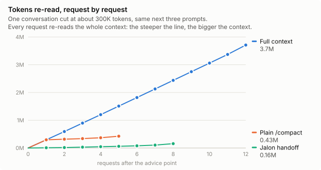
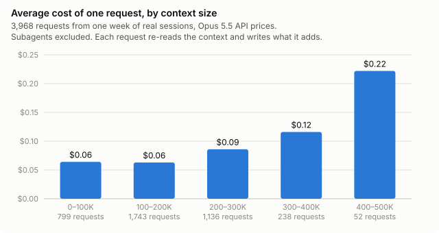

# Cost and quality

## Why a large context costs

A coding agent resends the whole conversation with every request, and one prompt often makes several requests: one per tool call, when the agent reads a file, searches or edits. The prompt cache makes re-reading cheaper, but not free.

The amounts below are what an API key pays. On a subscription you do not pay per token, but the same tokens count against your usage limits.

An example with Claude Opus 5.5 at API prices ($0.20 per million cached tokens read, $8 per million written to the one-hour cache these requests used, $20 per million output tokens), from real requests with a few hundred tokens of output each:

| | Context at 50K | Context at 300K |
|---|---|---|
| Re-reading the context, per request | about $0.01 | about $0.06 |
| One whole request, with its output | about $0.03 | about $0.08 |
| One prompt that makes ten requests | about $0.35 | about $0.85 |
| The first request after the cache expired | about $0.40 | about $2.30 |

At 300K every request pays six times more to re-read the context than at 50K, for the same answer. After a pause longer than the cache lifetime, the next request writes the whole context to the cache again, which costs forty times more than reading it. A reset is best taken before such a pause, but once the cache has expired a `/compact` still costs less than going on ([after a pause](#after-a-pause)).

A reset brings the context back to its starting size, usually tens of thousands of tokens, and every request after it is that much cheaper.

## What a replay of real conversations showed

Four real conversations from my own work were each cut at about 300K tokens, then replayed three ways over their next prompts: with their full context, after a Jalon handoff, and after a plain `/compact`. Each replay ran in an isolated copy of the repository at its state of the time, and a model judge compared the answers blind.

<picture>
  <source media="(prefers-color-scheme: dark)" srcset="../assets/reread-per-request-dark.svg">
  
</picture>

One of the four conversations, request by request. Each point is one request; the compaction request is counted, and the handoff was written in the answer just before the first point.

- **Cost.** Over the four conversations, the full context re-read about 14M tokens, a plain `/compact` about 3M counting the compaction requests, and the handoff about 1.6M.
- **Quality.** The handoff did as well as the full context: each won some conversations. In one, the full-context run undid a fix decided earlier in the conversation. The handoff did better than a plain `/compact` in three of the four. The later tests below, with more cuts, larger contexts and stale answers counted apart, did not find that quality gap: there, a long context answered as well as a reset one.
- **What a reset can lose.** Content fetched from outside tools, such as tickets read through an MCP server, was lost when the handoff did not state it. The handoff instruction now asks for it.

One run per conversation, from my own work with one model: a hint, not a proof. Check the thresholds against your own history with the [impact report](impact-report.md).

## What a week of real use showed

Five days of my own sessions with Jalon 0.1.0, 2026-10-11 to 2026-10-15, in two projects: 48 sessions, about $505 at the Claude Opus 5.5 prices above. 12% of the requests went to Claude Sonnet 5.5; at each model's own price the week cost $487.

<picture>
  <source media="(prefers-color-scheme: dark)" srcset="../assets/cost-per-request-dark.svg">
  
</picture>

- **Below 200K a request costs about the same**: what it writes to the cache and its output weigh more than re-reading the context. Above, the re-reading takes over, and a request at 400K costs three and a half times one at 100K.
- **A reset brings the context back down.** The 12 sessions resumed from a handoff started at 43K to 57K, and the 5 `/compact` followed by a request landed at 46K to 77K. The 12 resumed sessions cost $117; the same requests on the context left behind would have re-read $82 more. That counts the same requests in both cases, so it is an estimate.
- **The cache expiring costs less than the context size.** 21 requests rewrote the whole context after a pause of more than an hour or a `/model` switch: $27, 5% of the week.
- **Subagents are 41% of the cost**, and Jalon does not change it. Starting them costs little: the first request of each of the 108 subagents is 6% of their cost. The cost comes from long subagents whose context grows like a main conversation: the 13 that went past 200K, up to 417K and 154 requests, are 47% of it. The rest is re-reading the cache (27%), writing to it (20%) and output (12%).

## What later recall tests showed

Two tests, on conversations from my own work, each copied and cut before its first compaction, then asked questions in a one-turn `claude -p` session with every tool disabled. The answers were graded against a key written before any run.

- **One conversation, Claude Opus 5.5, cut at 130K, 211K and 403K tokens**, four questions on facts and on the latest version of a file: every answer was correct at every size, and after a `/compact`. Too easy to tell the conditions apart.
- **Two conversations, Claude Sonnet 5.5 at medium effort, each cut twice**, at 130K to 140K and at 300K to 560K tokens. Eight questions per cut, most on values that changed two to five times before the cut (the current order of a list, the latest value of a setting, a decision that replaced an earlier one), plus facts from the start and the next step. Three conditions: the full context, a `/compact`, and a new session given the handoff the model wrote at the cut. Two runs each, 192 answers.

| | Full context | `/compact` | Handoff |
|---|---|---|---|
| Correct | 61 of 64 | 56 of 64 | 54 of 64 |
| Stale (an earlier value given as the current one) | 0 | 1 | 0 |

- **Size did not hurt.** The full context kept every value that had changed, up to 560K tokens. Of its three misses, two were the next-step question at the largest cut, which every condition missed, and one a partial answer at 138K.
- **A reset lost details, not the state of the work.** The `/compact` dropped two exact values at about 300K, a line range and the text of a warning. The handoff dropped the path of a file named at the start. Both kept the values that had changed.
- **Writing a handoff costs more than compacting.** At 560K, writing the handoff cost $2.23 and the `/compact` $1.12, at Sonnet prices.

So a reset is worth it for what it saves, not for better answers, and it should keep exact values word for word: the advice asks for that.

Limits: one person's work, questions answered in one turn rather than multi-turn work with tools, one model per test, each `/compact` and handoff made once per cut, and about 40 answers graded by hand, mostly correct ones that also named the earlier value as replaced.

## After a pause

One conversation of mine at 195K tokens, Claude Opus 5.5, copied and resumed in `claude -p`; two runs with a warm cache, one with an expired one.

| | Going on | `/compact` | Handoff, then a new session |
|---|---|---|---|
| Warm cache | about $0.06 a request | $0.15, paid back after about 8 requests | $0.34, paid back after about 9 |
| Expired cache, one-hour lifetime | about $1.38 for the first request | about $0.99, cheaper at once | about $1.67 |

The expired row is computed for the one-hour cache from a run with the five-minute one. Going on writes the whole context to the cache again; a `/compact` sends it once as plain input, at half the write price, and what follows starts small.

Recent Claude Code versions compact on their own during a long pause once the context reaches 200K tokens. In my 30 days below, that happened 13 times, all in the VS Code extension or the desktop app.

## What 30 days of real use showed

My own sessions from 2026-10-21 to 2026-11-20, read by `jalon context-report --since 30d`: 272 conversations started across 20 projects, 2.2B prompt tokens read, 98% of them from the cache.

- **Resets avoided re-reading about 1.1B prompt tokens**, 34% of what would have been read, of which 21% after a Jalon advice. That counts the same requests after each reset as if the conversation had gone on the same way, so it is an estimate.
- **A reset brings the context back down.** After the 58 resets, the next request was at 48K to 86K after a handoff and at 57K to 103K after a compaction.
- **The starting size is 36% of the prompt tokens read**, at 54K per conversation at the median (48K to 60K for most), and no reset removes it: it is what the client, its tools, skills and MCP servers, and `CLAUDE.md` load before the first message.
- **Returns after the cache expired:** 80 typed prompts, after a median pause of about three hours, wrote 9.2M prompt tokens to the cache again: 0.4% of the tokens, but about $74 at the one-hour write price, since a write costs forty reads.
- **Subagents:** the 13 of 339 that grew past 200K tokens above their start read 27% of all the subagents' prompt tokens. Jalon does not advise subagents.
- **Usage limits.** In one measurement on my subscription, cache reads and cache writes counted against the five-hour limit at their list price: 1% of that limit was worth about $1.1 to $1.8 of list-price usage, reads and writes alike. So the amounts on this page also tell what a reset spares of the limits.

One person's work: a hint, not a proof. The impact report gives the same figures on your own history.
