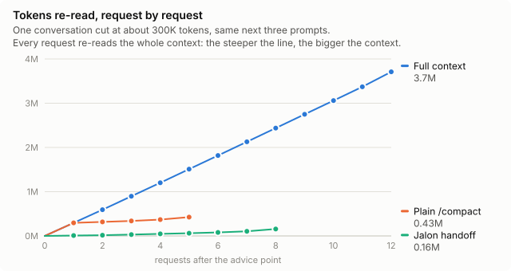

# Cost and quality

## Why a large context costs

A coding agent resends the whole conversation with every request, and one prompt often makes several requests: one per tool call, when the agent reads a file, searches or edits. The prompt cache makes re-reading cheaper, but not free.

The amounts below are what an API key pays. On a subscription you do not pay per token, but the same tokens count against your usage limits.

An example with Claude Opus 5.5 at API prices ($0.20 per million cached tokens read, $8 per million written to the one-hour cache these requests used, $20 per million output tokens), from real requests with a few hundred tokens of output each:

| | Context at 50K | Context at 300K |
|---|---|---|
| Re-reading the context, per request | about $0.01 | about $0.06 |
| One whole request, with its output | about $0.03 | about $0.08 |
| One prompt that makes ten requests | about $0.35 | about $0.85 |
| The first request after the cache expired | about $0.40 | about $2.30 |

At 300K every request pays six times more to re-read the context than at 50K, for the same answer. After a pause longer than the cache lifetime, the next request writes the whole context to the cache again, which costs forty times more than reading it.

A reset brings the context back to its starting size, usually tens of thousands of tokens, and every request after it is that much cheaper.

## What a replay of real conversations showed

Four real conversations from my own work were each cut at about 300K tokens, then replayed three ways over their next prompts: with their full context, after a Jalon handoff, and after a plain `/compact`. Each replay ran in an isolated copy of the repository at its state of the time, and a model judge compared the answers blind.

<picture>
  <source media="(prefers-color-scheme: dark)" srcset="../assets/reread-per-request-dark.svg">
  
</picture>

One of the four conversations, request by request. Each point is one request; the compaction request is counted, and the handoff was written in the answer just before the first point.

- **Cost.** Over the four conversations, the full context re-read about 14M tokens, a plain `/compact` about 3M counting the compaction requests, and the handoff about 1.6M.
- **Quality.** The handoff did as well as the full context: each won some conversations. In one, the full-context run undid a fix decided earlier in the conversation. The handoff did better than a plain `/compact` in three of the four.
- **What a reset can lose.** Content fetched from outside tools, such as tickets read through an MCP server, was lost when the handoff did not state it. The handoff instruction now asks for it.

One run per conversation, from my own work with one model: a hint, not a proof. Check the thresholds against your own history with the [impact report](impact-report.md).
