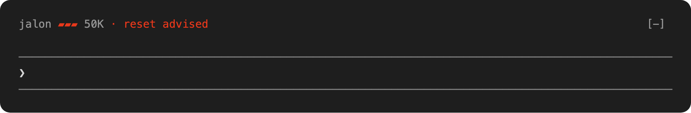

# How it works

Jalon cannot reset a conversation itself, since editing history would break the prompt cache. So it tells you when, and the session's own model prepares how. There is no extra API call, and no conversation text leaves your machine.

## When it advises

The hooks read the context size from the conversation's transcript, and the **starting size** (the floor) from the conversation's first request, once. The floor is what a reset cannot remove: the system prompt, the tool definitions (MCP included), the agent and skill listings. A conversation that starts at 220K is not advised at its first prompt.

- `advise_tokens` is the growth above the floor at which the first advice comes (200K by default).
- `advise_step_tokens` is how much the context must grow after an advice before the next one (150K by default). It counts from the size at the last advice.
- After a compaction or a new session the context is much smaller, and the step starts again.

The defaults are a judgment, not a measurement: the [replay test](cost-and-quality.md) backs resetting a large context, not these exact values. Check them against your own history with the [impact report](impact-report.md), and change them with `jalon init --advise-tokens` (see [configuration](configuration.md)).

The advice comes only on prompts you type, not on messages from other sessions or background tasks, and only in a session a person typed in: a script or an agent that runs `claude -p` reads the model's last message as its output, so Jalon leaves the sessions it starts alone. It tells them apart from the transcript, where Claude Code marks a typed prompt; a session counts as typed in from the prompt after the first one you type. Known limit: a program that resumes a session you typed in, with `claude -p --resume`, is not detected, since the session stays recorded as typed in, so its prompts can get the prompt hook's advice; the stop hook checks the turn's own prompt and leaves such a turn alone. The hooks work in the terminal and in the VS Code extension, need no other process, never block your prompt, and give up after 500 ms.

Two hooks give the advice. The **prompt hook** runs before each prompt you type is sent, and adds the advice to the model's context. The **stop hook** runs when the model ends a turn you started, and acts in two cases:

- the context crossed the threshold during the turn: it gives the advice then, instead of at your next prompt, which can come many requests later;
- the prompt hook advised at the start of the turn, and the reply does not end with the Jalon section: it reminds the model once, unless Claude Code compacted the conversation during the turn, so the advice shows even where the client shows no notice, as in the VS Code extension.

In both cases it blocks the end of the turn once: the model goes on in the same turn, with one more request or more when it writes the handoff, and adds the section after the reply you already see; it is never asked to repeat its answer. A reply that already ends with a Jalon section, which some models repeat on their own after a first advice, is not blocked: the crossing is recorded, so the next advice comes one step later. The stop hook reads the size from the transcript, where Claude Code has not yet written the turn's last request when the hook runs: a crossing that only the last request shows is advised at your next prompt instead.

A replay of 54 real sessions of one week through the hooks of 0.1.0, which had only the prompt hook, and of the stop hook, with each transcript fed line by line and the turn's last request held back as Claude Code does: the stop hook advised 2 sessions that 0.1.0 never advised, since no prompt was typed after the crossing, and 2 others earlier, at 256K instead of 317K and at 259K instead of 297K. A turn that grows the context by itself still gets the advice only at its end: one that went from 72K to 365K was advised at 365K, against 372K at the next prompt with 0.1.0.

## What you see

At the first prompt past the threshold, the terminal shows a one-line notice, `Jalon: context at 212K tokens, a reset proposal follows the answer.` (the VS Code extension does not show it), and the model is asked to answer your message first, then end its reply with one recommendation, in the language you write in, in a quoted block that starts with **Jalon** so you can tell where it comes from, and only in that reply:

1. a **new session**, when the task has changed;
2. a **handoff**: the model writes a file in `.jalon/handoffs/` and gives you the lines to resume from it, which name no task (see [handoffs](handoffs.md));
3. a **`/compact` line** naming what to keep and what to drop.

While background work the model started that will report back (agents, background commands) is still running, the model is asked not to recommend a new session or `/clear`, but to write the handoff now, while the whole conversation is in context, then give a `/compact` line that keeps the running work and names that handoff's path, and the line to type once the work has reported: `/jalon-handoff`, which updates that handoff with the work's results (or, without the command, a request to do so). A compaction keeps a summary written without knowing what comes next; the handoff written before it keeps the decisions, what was dropped and what was checked.

The section also says how long the prompt cache keeps the context, an hour or 5 minutes, as the conversation's last request wrote it to the cache. After a longer pause the next request writes the whole context to the cache again, and so does a `/compact` or a handoff taken then, which costs forty times reading it with the one-hour cache (see [cost and quality](cost-and-quality.md)). So a reset is best taken before a pause. When the last request wrote nothing to the cache, the line is left out.

When the threshold is crossed during a turn, the section comes as a message of its own after the reply, and the terminal shows `Jalon: context at 296K tokens, a reset proposal follows.` The terminal also shows what the stop hook asked the model, labelled `Stop hook feedback`. The hook sends it as additional context, which Claude Code reads since 2.1.163 (checked with 2.1.306); an older Claude Code ignores it, and the section does not come.

You run the command; Jalon never does.

## Status line

`jalon init` adds it. It shows in the terminal only (the VS Code extension has none): a pole of three bands, then the size:

```
jalon ▱▱▱ 40K
jalon ▰▱▱ 95K
jalon ▰▰▱ 160K
jalon ▰▰▰ 230K · reset advised
```

A band fills at each third of `advise_tokens` of growth above the floor, so the pole is full, and `· reset advised` shown, by the hook's rule. It stays full after the first advice. The filled bands are red; set `NO_COLOR` to drop the color. With the advisor disabled, it shows the size alone: `jalon 230K`. It reads the floor from the state file the hook keeps for the session, and writes nothing; until the hook has run in a session, it counts from zero. It prints nothing when the size is unknown, and gives up after 200 ms.

`jalon init` sets it when you have none, and never replaces yours; `jalon init --statusline=false` leaves it out. To add it to an existing status line, pipe the same stdin to both commands in a small script and join their outputs:

```sh
#!/bin/sh
input=$(cat)
printf '%s  %s' "$(printf '%s' "$input" | ~/bin/my-status.sh)" "$(printf '%s' "$input" | jalon statusline --client claude-code)"
```

## The pole above the prompt

An alternative to the status line: a Claude Code mod, in `plugin/`, draws the same pole on a row of its own above the prompt, with `· reset advised` in red. It also shows in the Code tab of Claude Desktop; the VS Code chat panel does not draw mods, so it shows nothing there, and does not run the binary. Install it in place of the status line:

```
jalon init --mod
```



*A real Claude Code session, with `advise_tokens` lowered to 6K so the pole fills in a few prompts.*

The mod only draws. After each turn, and when a session starts or resumes, it runs `jalon statusline` with the context size Claude Code reports and draws its answer, so the rule stays the binary's and the mod writes nothing. It updates at the end of a turn, where the status line updates during it. It draws nothing when the binary is missing or fails, or when the advisor is disabled.

Prefer the status line unless you want the pole in Claude Desktop or on a row of its own:

- **Claude Code's mod API is early access** and may change between releases; a change can stop the mod from drawing until it is updated.
- **It needs Claude Code 2.1.292 or later**, and runs as code inside Claude Code, with your permissions; an organization can block mods it does not manage.
- **It does not update with Jalon.** Claude Code does not update mods from a marketplace like this one unless you turn auto-update on, in `/plugin`, Marketplaces. Otherwise run `claude plugin update jalon@jalon`.

`jalon init --uninstall` removes it with the rest; `jalon init --statusline` cannot be combined with `--mod`.

## Codex

Codex CLI's hooks take the same input and output as Claude Code's, so the advice, the stop hook and the handoff work the same way. In a real Codex 0.163.0 session, with `advise_tokens` lowered to 3K, the prompt hook's advice shows as:

```
› What is the first word of line 2 of notes.txt?
↳ Hook · Jalon: context at 17K tokens, a reset proposal follows the answer.
• maple
  > Jalon — Compact is a good fit; there's little state to carry.
  >
  > /compact Keep that notes.txt line 2 begins with "maple"; drop the file dump.
```

When the stop hook makes the model go on, Codex shows `Blocked by hook`, the notice, then what it asked the model, before the section. What differs from Claude Code:

- **The size** comes from the session's rollout file, which Codex passes to the hooks: the input tokens of the last request, cached ones included, from its last `token_count` event, or Codex's own estimate right after a compaction. Codex documents that file as not a stable interface, so a Codex release can change what Jalon reads.
- **Sessions a program drives** are told apart by where the session started, as the rollout's first line records it: the interactive CLI and the IDE extension get the advice, `codex exec` and other programs do not.
- **The commands** are `/new` and `/compact`, and the resume line gives the handoff's path as plain text, which the model reads.
- **No status line, mod or skills**: Codex's status line shows only its own items, such as `context-used`, and runs no command, and `jalon init --client codex` installs no `/jalon-*` command. The impact report reads Claude Code transcripts only.
- **Trust**: Codex runs a new or changed hook only once you trust it in `/hooks`, so after `jalon init --client codex`, and after a reinstall that changes the hook's path, open `/hooks` and trust Jalon's. A session started after the install asks for it on its own, with `Hooks need review`.
- **Known limit**: Codex keeps the advice the prompt hook adds in the conversation, and in that session the model, GPT-6-Luna, ended every later reply with a Jalon section, though the advice asks for it once.

## Other clients

Everything specific to Claude Code sits in `internal/client/claudecode`, and to Codex in `internal/client/codex`, behind the `client.Adapter` interface in `internal/client/client.go`: how to read the hook input, find the context size and the typed prompts, write the hook output, the reset commands, through the optional `client.Stopper` how to read a stop event and block the end of a turn, and through the optional `client.Installer` how to install the hooks. To add a client, implement that interface in `internal/client/<name>/`, register it in `cmd/jalon/clients.go`, and install `jalon hook prompt --client <name>` as that client's prompt hook, and `jalon hook stop --client <name>` as its stop hook when it has one.

The integration tests, in `cmd/jalon/e2e_test.go` for Claude Code and `cmd/jalon/e2e_codex_test.go` for Codex, run the real client against a fake model API that reports chosen context sizes; another client can be tested the same way once it has an adapter, with a fake of the API it calls.
